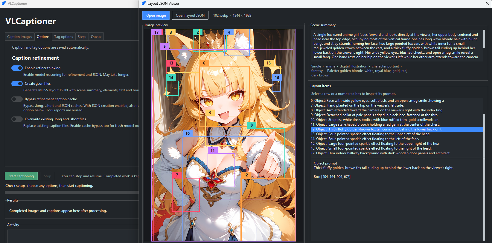
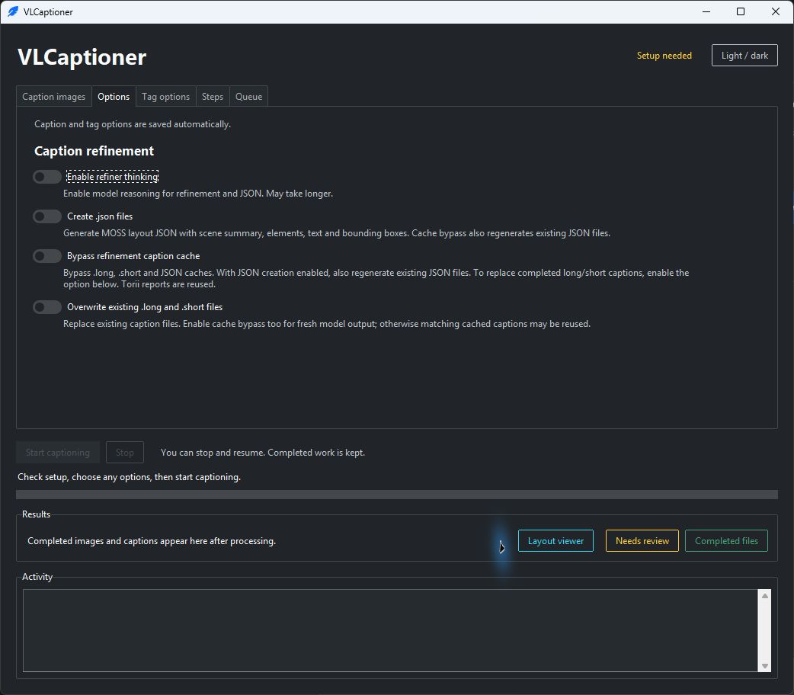
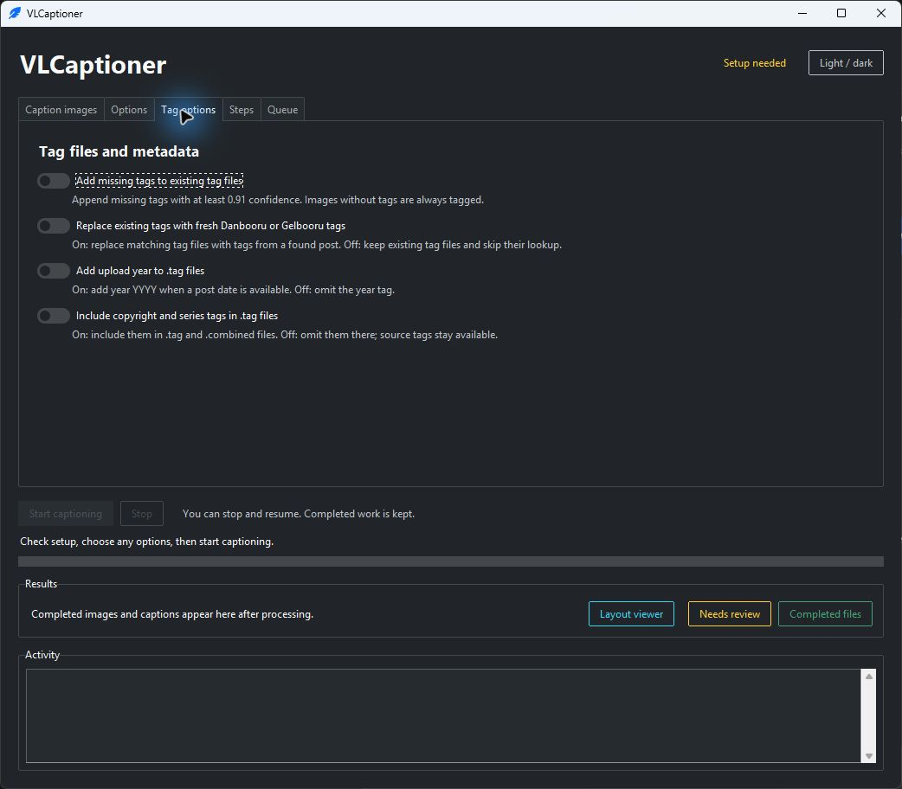

# VLCaptioner

VLCaptioner (Visual Language Captioner) prepares image datasets with short
captions, detailed captions, and Danbooru-style tags. It uses ToriiGate to
analyze images and a second Ollama vision model to refine the captions.
Finished images and text files are saved in `done/`.

It is primarily designed for datasets from **Danbooru and Gelbooru**, using
their tags and metadata to guide caption generation.

Ollama can run locally or on another computer on your network. Optional
AnimeTimm/WD14 tagging runs on the computer running VLCaptioner.

- **Caption datasets:** generate short captions, detailed captions, and cleaned tags.
- **Collect and organize:** download from Danbooru or Gelbooru, inspect dataset tags,
  and copy or move matching images with their companion files.
- **Review results:** keep completed sets in `done/` and flagged sets in
  `captionReview/`; optionally generate layout JSON sidecars.

[Quick start](#quick-start) · [Workflow](#workflow) · [Options](#options) ·
[Outputs](#output-files) · [Tools](#tools) · [Help](#troubleshooting)

[](docs/images/layout-viewer-preview.png)

<p>
  <a href="docs/images/caption-options.jpg"></a>
  <a href="docs/images/tag-options.jpg"></a>
  <br>
  <sub>Caption and tag options in the current interface. Click either screenshot to view full-size.</sub>
</p>

## Quick start

You need **Python 3**, **Git**, a **Danbooru account and API key**, and an
**Ollama server** with enough memory for the selected vision models. An NVIDIA
GPU is recommended. Ollama can run locally or on another computer; the optional
AnimeTimm/WD14 tagger runs on the VLCaptioner computer and also supports CPU.
Both installers install CUDA-enabled PyTorch locally.

### 1. Install

```console
git clone https://github.com/Ikena1992/VLCaptioner.git
cd VLCaptioner
```

On **Windows**, install Python with **Add Python to PATH** enabled, then run:

```powershell
.\install.bat
Copy-Item config.example.txt config.txt
```

On **Debian or Ubuntu**:

```bash
sudo apt update
sudo apt install -y python3 python3-venv python3-tk git
bash scripts/4_install.sh
cp config.example.txt config.txt
```

Both installers create the Python environment in `data/env`.

### 2. Configure Ollama and API access

Start Ollama on the computer that will run the vision models. Edit `config.txt`
and replace the Danbooru placeholders with your credentials. If you use Gelbooru,
also fill in `GELBOORU_USER_ID` and `GELBOORU_API_KEY` with your Gelbooru credentials.
Keep this file private.
For a remote server, change `OLLAMA_URL` to its private network address.

| Setting | Default / value to supply |
| --- | --- |
| `OLLAMA_URL` | `http://localhost:11434` |
| `TORII_OLLAMA_MODEL` | `hf.co/DraconicDragon/ToriiGate-0.5-GGUF:Q4_K_M` |
| `OLLAMA_MODEL` | `orcarouter/Qwen3.8-27B-Uncensored:q4_K_M` |
| `DANBOORU_LOGIN` | Your Danbooru login |
| `DANBOORU_API_KEY` | Your Danbooru API key |
| `GELBOORU_USER_ID` | Your numeric Gelbooru user ID, if using Gelbooru |
| `GELBOORU_API_KEY` | Your Gelbooru API key, if using Gelbooru |

VLCaptioner asks Ollama to download missing models when captioning starts.
The first run can take longer; model downloads and inference happen on the Ollama
host. Both models must accept images and fit its available memory.

See [setup and configuration](docs/setup.md) for remote-server setup, optional
Gelbooru credentials, manual model downloads, and AnimeTimm access.

### 3. Caption a small batch

Launch the GUI from the project folder:

| Windows | Linux |
| --- | --- |
| `.\GUI.cmd` | `bash GUI.sh` |

1. Review **1. Check setup** for API and Ollama readiness.
2. Use **2. Download images (optional)** → **Open image downloader**, or add
   images directly to `images/`. Subfolders are not processed by the captioner.
3. For a simple first test, add `sample.webp` and a matching `sample.txt`
   containing tags such as `1girl, blue_hair, outdoors`.
4. Click **Check again**, review **Options** and **Tag options**, then select
   **Start captioning**.
5. Inspect `done/` and `captionReview/` before starting a larger batch.

**Use copies of your originals.** Conversion replaces non-WebP inputs with WebP;
finalization moves processed sets out of `images/`. Non-WebP images are resized
to fit within 3000 × 3000 pixels and transparency is flattened onto white.
Existing WebP files are left unchanged by conversion. Supported inputs:
`.jpg`, `.jpeg`, `.png`, `.bmp`, `.tiff`, `.gif`, `.webp`; animations are not preserved.
Use unique base filenames to avoid image and companion-file conflicts.

## Updating

Close VLCaptioner and run `update.cmd` on Windows. It updates the current branch
from its configured upstream using a fast-forward pull. Local changes are preserved
when they do not interfere with incoming updates. Changes that would be overwritten,
a detached checkout, or diverged history stop the update with an explanation.
The updater does not reset or stash your work. Ignored configuration, datasets,
and caches stay local. If dependencies changed, rerun `install.bat`.

For unattended use, run `update.cmd --no-pause`; success returns exit code `0`
and failures return `1`.

## Workflow

```text
images/ → conversion → source tags + metadata → Torii analysis → refinement
                                                             ↓
                                                   caption quality check
                                                   ↙                  ↘
                                                done/           captionReview/
```

For MD5-named images, tag lookup checks Danbooru, then Gelbooru. Existing source
tag files are kept unless replacement is enabled. Missing or blank tags are
filled locally by AnimeTimm; if access is denied, SmilingWolf EVA02 Large v3 is
used instead. The **Add missing tags** option controls additions to existing
tag files; it does not disable tagging images that lack tags.

The **Steps** tab shows progress and the **Activity** log explains failures.
Per-image failures leave the affected images for a later run while other images
continue; setup or model failures can stop the run. **Stop** keeps completed work.
Start again to retry remaining images using existing caches where possible.

See the [captioning reference](docs/captioning.md) for metadata handling,
quality checks, recovery, and regeneration details.

## Options

Options and theme choices are saved locally and restored on the next launch.
The following switches default to off; thinking and JSON defaults can also be
set in `config.txt` for the command line and first GUI launch.

| Tab | Option | When to enable it |
| --- | --- | --- |
| Options | **Enable refiner thinking** | Use reasoning with a compatible refiner; processing can take longer. |
| Options | **Create .json files** | Generate MOSS layout prompts with item descriptions and bounding boxes. |
| Options | **Bypass refinement caption cache** | Request fresh captions and, when JSON creation is enabled, regenerate JSON. |
| Options | **Overwrite existing .long and .short files** | Replace caption files already present in the input set. |
| Tag options | **Add missing tags to existing tag files** | Append missing high-confidence local tags. |
| Tag options | **Replace existing tags with fresh Danbooru or Gelbooru tags** | Refresh source tags from the first matching post. |
| Tag options | **Add upload year to .tag files** | Include `year YYYY` when an upload date is available. |
| Tag options | **Include copyright and series tags in .tag files** | Retain these tags in `.tag` and `.combined`. |

To regenerate a completed image, copy it and its source `.txt` back to `images/`.
Enable caption overwrite to replace existing captions, and cache bypass to request
fresh model output. These controls are independent.

For JSON coordinates, validation, thinking behavior, and visible-text handling,
see [advanced captioning](docs/advanced.md). Use **Layout viewer** in the GUI or
run `LayoutViewer.cmd` to inspect JSON boxes on their source image.

## Output files

Completed sets go to `done/`; flagged sets and their companion files go to
`captionReview/`. Generated captions and estimated layout boxes need review
before use in training.

| File | Contents |
| --- | --- |
| `NAME.webp` | Processed image. |
| `NAME.short` | Compact natural-language caption. |
| `NAME.long` | Detailed natural-language caption. |
| `NAME.tag` | Cleaned and ordered tags. |
| `NAME.combined` | Tags followed by a dot and the short caption. |
| `NAME.txt` | Source tags, including fetched meta tags. |
| `NAME.json` | Optional MOSS layout prompt, when JSON creation is enabled. |

For example, `sample.webp` and `sample.txt` might produce:

```text
sample.short     A blue-haired character stands outdoors.
sample.tag       1girl, blue hair, outdoors
sample.combined  1girl, blue hair, outdoors. A blue-haired character stands outdoors.
```

Captions depend on the image and selected models. The [output reference](docs/captioning.md#output-files)
explains tag filtering, source metadata, and review criteria.

## Tools

### Image downloader

Open **Open image downloader** under **2. Download images (optional)**. Add a
Danbooru or Gelbooru search, enter space-separated tags, set a **Post limit**,
and click **Start downloads**. A post limit counts posts checked, so 100 posts
can yield fewer than 100 downloads. Optional blacklist tags apply to all rows.

Enable **Caption automatically** to process downloads in batches (default: 50)
while downloading continues. Manage batches in the captioner's **Queue** tab.
**Pause queue** lets the active batch finish; **Stop** interrupts active captioning.
Use **Retry selected** and **Resume queue** to continue failed or stopped batches.

### Dataset manager

Select **Open dataset manager**, choose folders, and click **Scan selected**.
Filter tag counts by category or dataset, preview matching images, and export
statistics as CSV. Scanning does not modify dataset files.

Use **Download more…** on selected tags to prepare searches. Set **Target in done**
to fill a dataset toward a desired count; leave it blank for ordinary downloads.

### Copy, move, and export

**Copy / move by tags** finds matching images and keeps companion files together.
It searches `.txt` by default; use `.tag` or `.combined` to match generated text.

For a captions-only ZIP, run `scripts/2_createZipFile.bat` on Windows or
`bash scripts/6_createZipFile.sh` on Linux. The resulting
`naturalLanguage_files.zip` contains `.short`, `.long`, `.tag`, `.combined`, and
`.txt` files from `done/`; images and layout JSON are not included.

See the [tools guide](docs/tools.md) for search rules, deduplication, queue
recovery, gap filling, and saved settings.

## Command line

Run the same pipeline without the GUI:

```powershell
# Windows
.\data\env\Scripts\python.exe data/pipeline_runner.py --skip-wd14
```

```bash
# Linux
data/env/bin/python data/pipeline_runner.py --skip-wd14
```

`--skip-wd14` keeps existing tag files unchanged by the high-confidence tagging
pass. Images without tags still receive local tagging when needed.

| Flag | Purpose |
| --- | --- |
| `--overwrite-danbooru-txt` | Refresh existing source tags. |
| `--overwrite-caption-cache` | Bypass refinement caches. |
| `--overwrite-caption-files` | Replace existing `.long` and `.short` captions. |
| `--refiner-thinking` / `--no-refiner-thinking` | Override configured thinking mode. |
| `--refiner-json` / `--no-refiner-json` | Override configured layout JSON generation. |

Use `data/pipeline_runner.py --help` with the installed Python environment for
all flags. [Cache and tag lookup details](docs/tools.md#run-without-the-gui)
explain how cached results and source metadata are reused.

## Troubleshooting

| Problem | First check |
| --- | --- |
| Cannot connect to Ollama | Confirm the server is running and `OLLAMA_URL` is correct; check network binding and firewall for a remote host. |
| Model download fails | Try `ollama pull` on the Ollama host; check the model name, access, and free disk space. |
| Requests time out | Increase `OLLAMA_TIMEOUT_SECONDS`. |
| Out of memory | Reduce other GPU workloads or choose a smaller refinement model or quantization. |
| Request exceeds context size | Increase `OLLAMA_CONTEXT_SIZE`, allowing room for the response; larger contexts need more memory. |
| Local tagging fails | Check AnimeTimm access and the local Python/GPU installation; inspect the log for the selected tagger. |
| Images remain without captions | Read **Activity** for missing tags, metadata, or unusable prompts, fix the cause, and rerun. |

GUI crash diagnostics stay local in `data/caches/crashes.log`.
See the [troubleshooting guide](docs/troubleshooting.md) for commands and detailed fixes.

## Documentation

- [Setup and configuration](docs/setup.md): installation, models, remote Ollama, API access.
- [Captioning reference](docs/captioning.md): conversion, tags, options, outputs, quality review.
- [Tools guide](docs/tools.md): downloads, dataset statistics, queues, export, and caches.
- [Advanced captioning](docs/advanced.md): thinking, layout JSON, coordinates, and viewer.
- [Troubleshooting](docs/troubleshooting.md): connection, model, memory, tagging, and crash diagnostics.

## Contributing

See [CONTRIBUTING.md](CONTRIBUTING.md) for development setup, local validation,
and pull request guidance. The [development guide](docs/development.md) maps the
main modules. Use [GitHub issues](https://github.com/Ikena1992/VLCaptioner/issues)
for bugs and feature requests, and follow the [security policy](SECURITY.md) for
vulnerability reports.

## License

VLCaptioner's software is licensed under [Apache 2.0](LICENSE). Third-party
models and data retain their respective terms.
